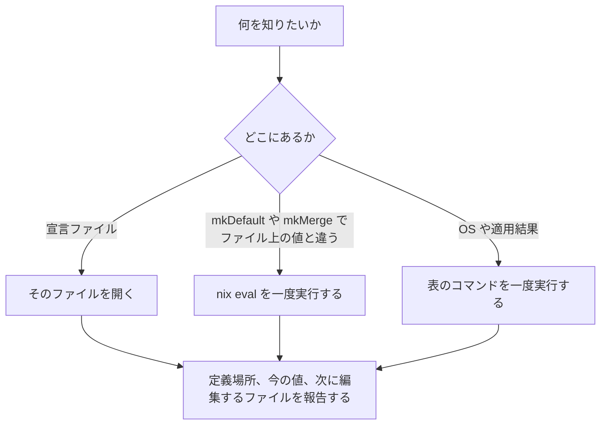
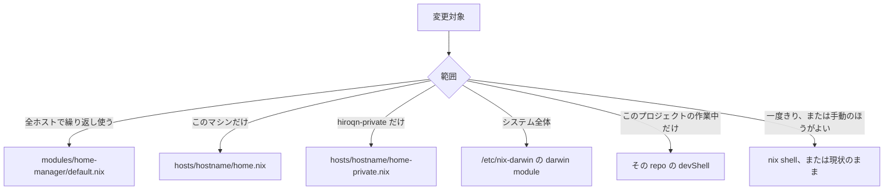
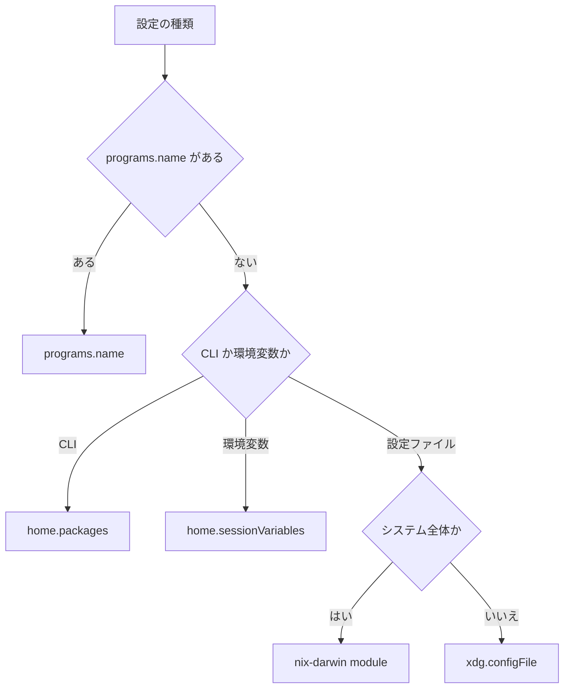
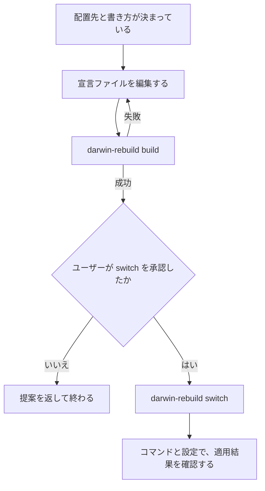
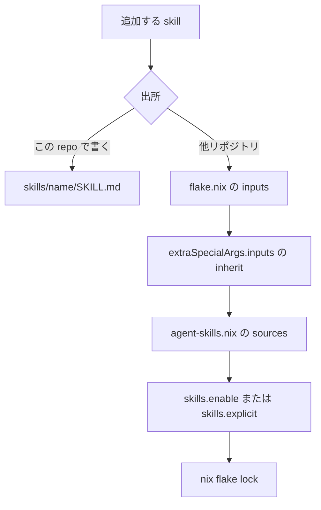

# About Env

このマシンの環境を調べるときに読む。設定を変えるときは、調べて特定した宣言ファイルだけを編集する。

## 原則

- **調べてから変える。** すでに管理している場所を先に見つけ、同じ設定を二重に書かない
- 宣言ファイルに書いてある値は、そのファイルを開いて確認する。生成されたファイルや `defaults read` で同じことを調べ直さない
- 宣言ファイルにない現在値は、下の表のコマンドを一度だけ実行する

## 手続き

依頼に合う図だけを使う。

### 現在の環境を確認する

どこで定義されていて、今どうなっているかを報告して終わる。



宣言にあるものは [宣言ファイルを一つ開く](#宣言ファイルを一つ開く)、宣言にないものは [宣言ファイルにない現在値](#宣言ファイルにない現在値) を見る。

### どのファイルがこのユーザーに届くか

`~/.zshrc` と `~/.config` は home-manager が生成したファイルである。`readlink` の先が `/nix/store` なら、そのファイルは編集しない。

| ユーザー | 開くファイル |
|----------|----------------|
| 両方 | `modules/home-manager/default.nix`、`modules/home-manager/agent-skills.nix`、`hosts/<hostname>/home.nix` |
| `hiroqn-private` | 上に加えて `hosts/<hostname>/home-private.nix` |
| `hiroqn` | 上に加えて、`/etc/nix-darwin/flake.nix` が足している home module |

`/etc/nix-darwin` が足している import には private module がある。名前もパスも中身も、この skill とこの repo には書かない。システム側を見るときは `/etc/nix-darwin/flake.nix` を開き、そこに書かれた import だけを追う。

### 変更をどこに置くか

変えると決めてから、どのファイルに書くかを決める。入れないと決めたら、ここで終わる。



| 種別 | 例 | 配置先 |
|------|-----|--------|
| CLI ツール | `jq`, `terraform`, `gh` | `home.packages` |
| プログラムの設定 | git, zsh, alacritty, direnv | `programs.<name>` |
| シェルの alias と初期化 | `ll`, zsh hook | `programs.zsh` / `programs.bash` |
| 環境変数 | `TF_PLUGIN_CACHE_DIR` | `home.sessionVariables` |
| 設定ファイルそのもの | アプリ固有の設定 | `xdg.configFile` |
| SSH、macOS の defaults | ホスト接続、Dock、Finder | `hosts/<hostname>/home.nix` |
| `hiroqn-private` 専用 | supermemory など | `hosts/<hostname>/home-private.nix` |
| プロジェクト専用 | 開発用の依存、プロジェクトの設定 | 各 repo の `flake.nix` / `devShell` |
| システム全体 | Nix の substituters、trusted-users | nix-darwin module |
| 自前の agent skill | `about-env` | `skills/<name>/` |
| 外部の agent skill | `test-audit` | flake input と `agent-skills.nix` |

**リポジトリに入れるもの:** 繰り返し使うもの、入れ直したあとも同じになっていてほしいもの、自分の開発環境として残したいもの。

**リポジトリに入れないもの:** 一度きりの試用、そのプロジェクトの devShell で足りるもの、ライセンスや Touch ID の都合で手元に置くもの（1Password、Rectangle、UTM など）、nixpkgs にないもの、必要なバージョンを満たせないもの。

判断がつかないときは、ユーザーに確認する。

```bash
nix shell nixpkgs#<tool>
```

### 設定をどの属性で書くか

書くファイルが決まってから、どの属性に書くかを選ぶ。`programs.<name>` があるかは [オプションの型](#オプションの型) で調べる。



`programs.*` で書けるものは `xdg.configFile` に書かない。書き方は、開いた宣言ファイルにすでにある属性に合わせる。

### 編集してから適用する

配置先と書き方が決まってから、この順で進む。`darwin-rebuild switch` は、build が成功し、ユーザーが承認してから実行する。



コマンドは [ビルドと適用](#ビルドと適用)。

### agent skill を追加する

パッケージを足す手順とは別である。うしろの編集は、前の編集が済んでいないと解決できない。詳細は [agent skill を追加するとき](#agent-skill-を追加するとき)。



## 対象を特定する

[変更をどこに置くか](#変更をどこに置くか) の表で、依頼がどの行に当たるかを決める。確認だけのときは、変える対象の代わりに、どの設定の今の値を見るかを決める。

## 宣言ファイルを一つ開く

`hostname` と `whoami` が分かってから、次のどれか一つを開く。ディレクトリごとにキーワード検索を繰り返さない。

| 知りたいこと | ファイル |
|--------------|----------|
| 両方のユーザーに入るパッケージ、git、zsh、alacritty、direnv | `~/GitHub/hiroqn/hiroqn/modules/home-manager/default.nix` |
| この Mac の SSH、Dock、Finder | `~/GitHub/hiroqn/hiroqn/hosts/$(hostname)/home.nix` |
| `hiroqn-private` だけ | `~/GitHub/hiroqn/hiroqn/hosts/$(hostname)/home-private.nix` |
| 有効な agent skill | `~/GitHub/hiroqn/hiroqn/modules/home-manager/agent-skills.nix` の `skills.enable` と `skills.explicit` |
| システム全体と、この repo の外の import | `/etc/nix-darwin/flake.nix` |
| 適用済みの Nix 設定 | `/etc/nix/nix.conf` と `/etc/nix/registry.json`。どちらも生成されたファイル |

Dock、Finder、SSH、git、zsh、alacritty の内容は、この表のファイルに書いてある。生成された `~/.zshrc` や `defaults read com.apple.dock` で確かめ直さない。

## 評価しないと分からない値

`mkDefault` や `mkMerge` で、ファイルに書いた値と評価後の値が違うときだけ実行する。ユーザー名には `whoami` の結果を入れる。

```bash
nix eval --json /etc/nix-darwin#darwinConfigurations.$(hostname).config.home-manager.users.$(whoami).<attr>
```

システムの Nix 設定は、`nix eval` の前に `/etc/nix/nix.conf` を見る。適用されている値はそこにある。

## 宣言ファイルにない現在値

右のコマンドかファイルを、項目ごとに一度だけ使う。

| 項目 | 一度で分かること |
|------|----------------|
| 今どの実行ファイルが使われるか | `command -v <name>` |
| ユーザーの profile に入っているコマンド | `ls ~/.nix-profile/bin` |
| システムの profile に入っているコマンド | `ls /run/current-system/sw/bin` |
| Homebrew の有無 | `command -v brew`。見つからなければ入っていない |
| Xcode / Command Line Tools | `xcode-select -p`。パスが出なければ入っていない。`/usr/bin/python3` は、未導入だとインストール画面を開く |
| OS、機種、メモリ、SIP、セキュア仮想メモリ | `system_profiler SPHardwareDataType SPSoftwareDataType` |
| ディスクの空き | `df -h /` |
| FileVault | `fdesetup status` |
| ファイアウォール | `/usr/libexec/ApplicationFirewall/socketfilterfw --getglobalstate` |
| Gatekeeper | `spctl --status` |
| タイムゾーン | `readlink /etc/localtime`。`systemsetup` には管理者権限が要る |
| 電源（バッテリーと AC で値が違う） | `pmset -g custom` |
| 画面の言語 | `defaults read -g AppleLocale` と `defaults read -g AppleLanguages` |
| 外観 | `defaults read -g AppleInterfaceStyle`。このキーがなければライトモード |
| 入力ソース | `defaults read com.apple.HIToolbox AppleEnabledInputSources` |
| sudo の Touch ID | `/etc/pam.d/sudo_local` に `pam_tid.so` があるか。探す文字列は `pam_tid.so` |
| 適用中のシステム | `readlink /run/current-system` と `darwin-version`。末尾のハッシュは nix-darwin の revision で、個人 repo の `git log` には出てこない |
| 適用した時刻 | `ls -ld /nix/var/nix/profiles/system` |
| システムの環境変数 | `/etc/zshenv` が source している `*-set-environment`。報告には変数名だけを書く |
| zsh のシステム alias | `/etc/zprofile` |
| bash のシステム alias | `/etc/bashrc` |
| 実際に効いている git の設定と、その出所 | 対象のディレクトリで `git config --show-origin --show-scope --get <key>`。`includeIf` の結果は、条件に合うディレクトリにいるときだけ出る |
| Nix の管理外にあるアプリの設定 | そのアプリ自身の設定ファイル。Cursor は `~/Library/Application Support/Cursor/User/settings.json` |
| launchd で動いているか | `launchctl print "gui/$(id -u)/org.nix-community.home.<name>"` |

シェルの `LANG` は `*-set-environment` に書いてある。画面の言語は `AppleLocale` なので、二つは別々に確認する。

`defaults read` が `does not exist` と返したら、そのキーは未設定で、macOS の初期値のままである。`AuthorizationCreate` で失敗したら、同じコマンドをサンドボックスの外で一度だけやり直す。

## オプションの型

オプションの名前、型、デフォルトを調べる。

```bash
HM=$(nix build --no-link --print-out-paths home-manager#docs-json)/share/doc/home-manager/options.json
ND=$(nix build --no-link --print-out-paths nix-darwin#optionsJSON)/share/doc/darwin/options.json

jq '."programs.git.enable" | {type, default, description}' "$HM"
```

パッケージの属性名は、次で調べる。

```bash
nix eval nixpkgs#<attr>.meta.description
```

## ビルドと適用

編集が終わってから build する。build が成功し、ユーザーが承認してから、sudo で switch する。

```bash
darwin-rebuild build --flake /etc/nix-darwin#$(hostname)
sudo darwin-rebuild switch --flake /etc/nix-darwin#$(hostname)
```

適用したあとは、変えたものに対応する確認を一度だけする。

```bash
command -v <tool>
git config --show-origin --get <key>
```

## agent skill を追加するとき

`skills/` には、このリポジトリで書く skill だけを置く。他のリポジトリの skill はコピーしない。コピーすると upstream の更新を取り込めず、こちらで直した差分だけが残る。

追加する順は [agent skill を追加する](#agent-skill-を追加する) の図のとおり。

他のリポジトリの skill は、upstream を flake input にして参照する。

1. `flake.nix` の `inputs` に、`flake = false` で追加する。
2. 同じファイルの `home-manager.extraSpecialArgs.inputs` の `inherit` に、その input を足す。この attrset は allowlist なので、`/etc/nix-darwin` 側の input を足しても、ここには入らない。
3. `modules/home-manager/agent-skills.nix` に source を足す。`subdir` は、`SKILL.md` があるディレクトリの親にする。
4. `skills.enable` に skill 名を足す。名前はディレクトリ名と揃える。`subdir` より深いときは `skills.explicit.<name>.path` を使う。
5. `nix flake lock` で、新しい input を pin する。

## 報告形式

確認だけのときは、編集案を出さずに、調べた結果を返す。

```markdown
## 環境の確認

- **対象**: ...
- **ユーザー**: `whoami` の結果
- **管理元**: 開いたファイルと属性。宣言にない項目は、実行したコマンド
- **現在値**: ...
- **生成物**: `/nix/store` への symlink は、その宣言から生成されたファイル
```

変更するときは、編集の前に提案を返す。

```markdown
## 環境変更提案

- **種別**: パッケージ追加 / プログラム設定 / 環境変数 / dotfile / agent skill
- **内容**: ...
- **導入判断**: 個人環境 repo / ホスト固有 / 個人ユーザー専用 / プロジェクト repo / 入れない（理由: ...）
- **配置先**: 編集するファイルと属性
- **既存**: 未管理 / すでにその属性で管理している
- **次の操作**: 編集 → `darwin-rebuild build` → 確認してから `sudo darwin-rebuild switch`
```

## 注意

- `flake.lock` を更新するときは、なぜ更新するかを書く
- この repo をビルドするときは、変更を `git add` してから実行する。flake は git が追跡しているファイルだけを取り込む
- `programs.*` で書ける設定を、`xdg.configFile` にも書かない
- private module の名前、パス、中身は、この skill とこの repo に書かない
